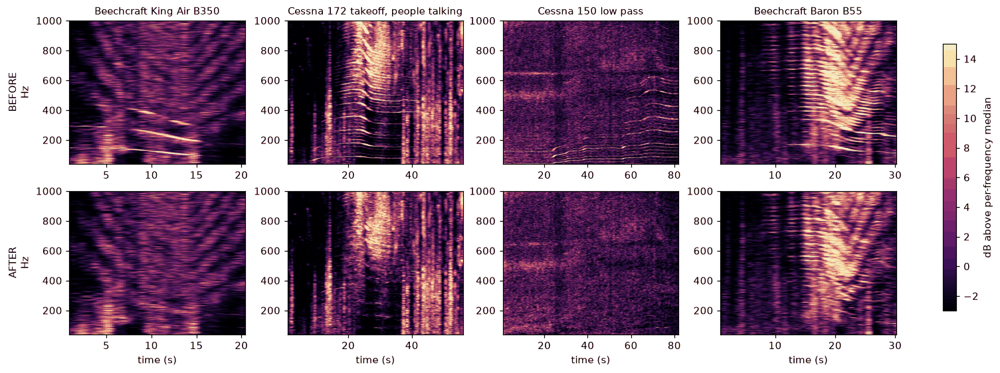
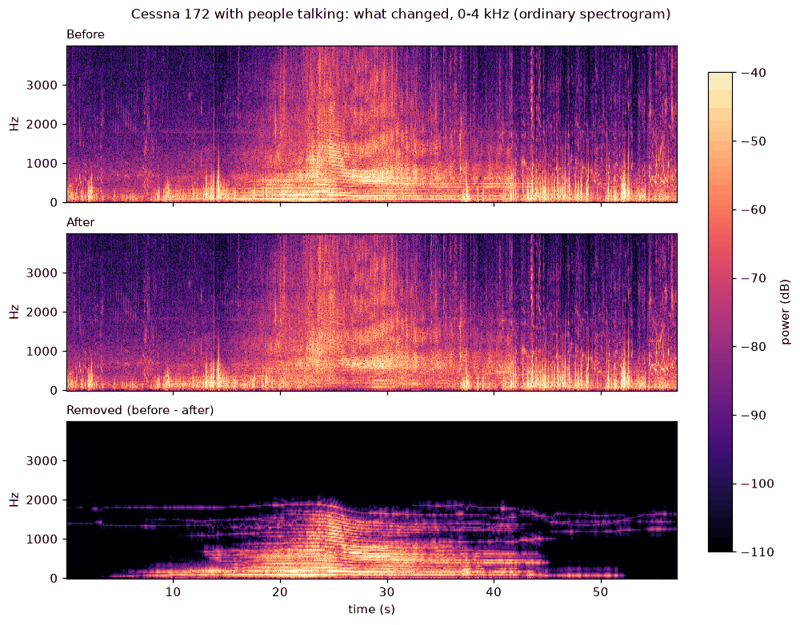
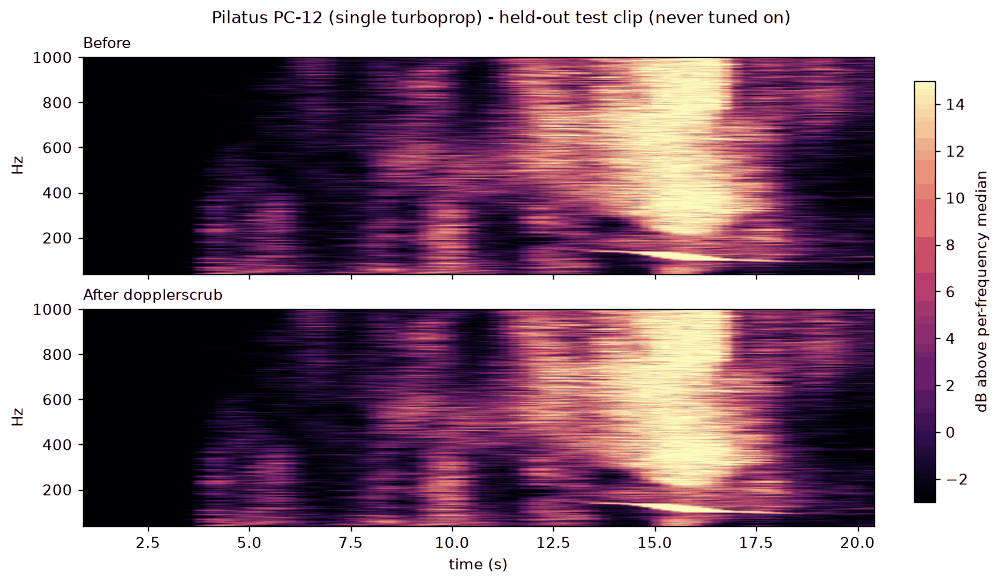
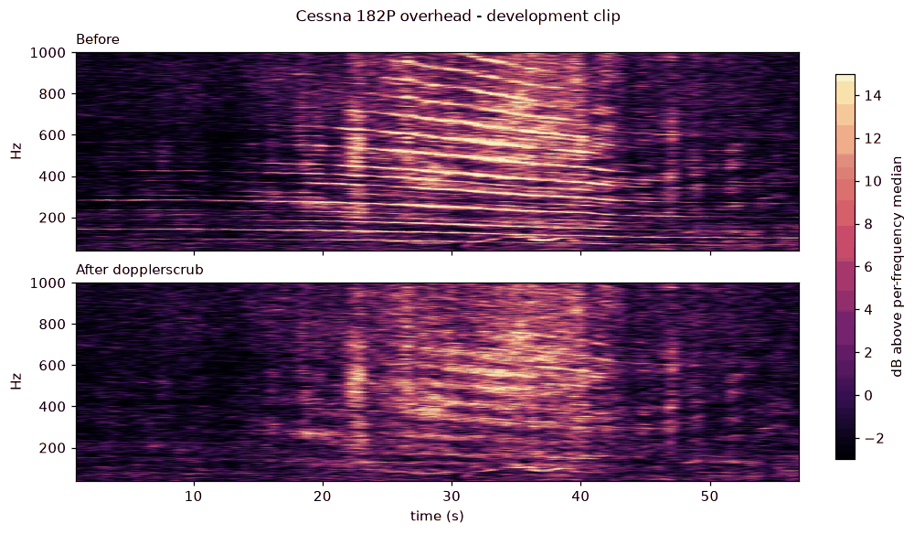
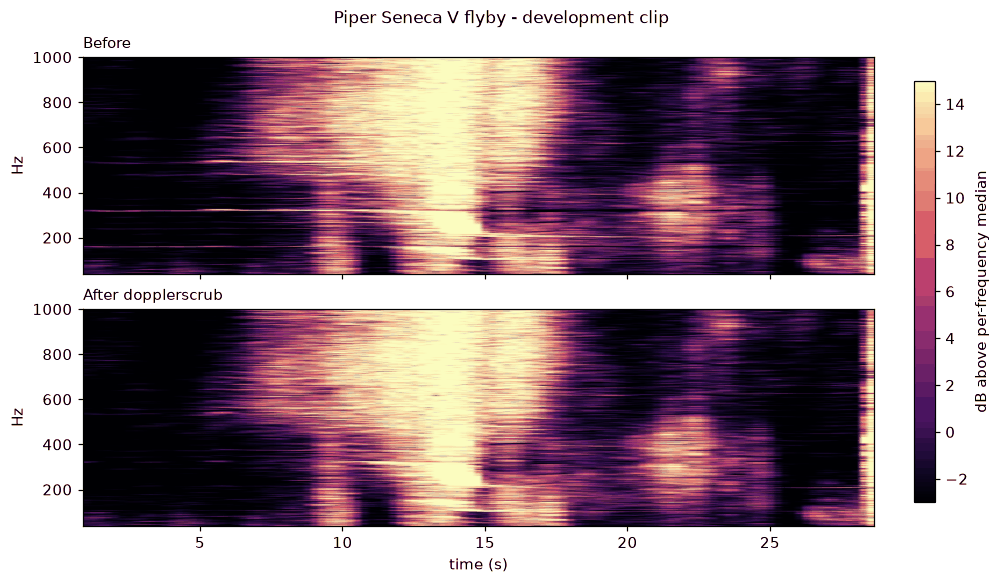
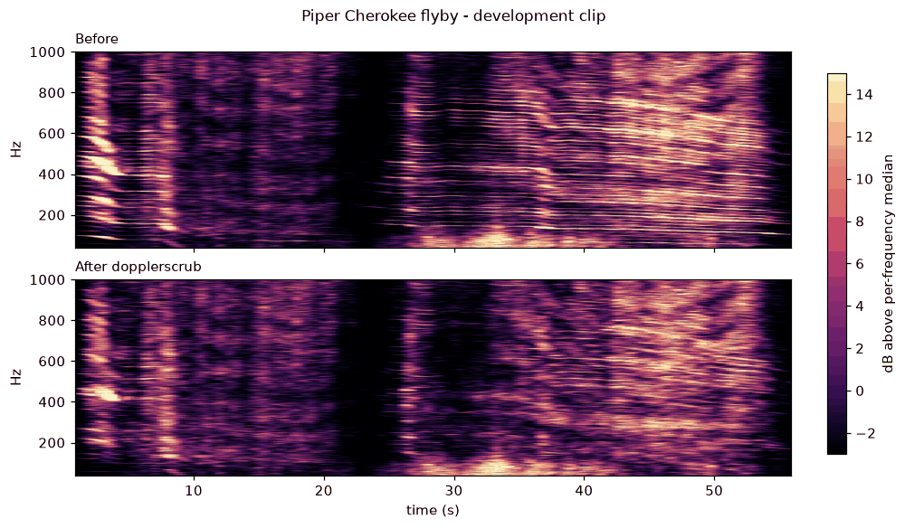
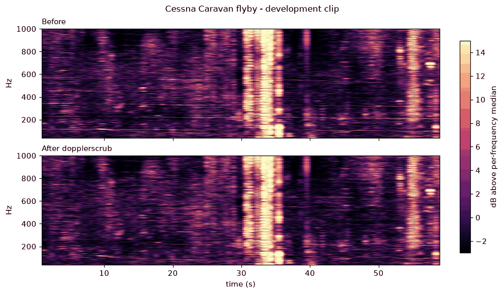

# dopplerscrub

**Remove propeller-plane Doppler tones from audio and video, so a recording can't be
geolocated from the planes flying over it.**



*Four recordings the tool had never seen before the final test (top: before, bottom: after),
shown the way an attacker would look at them (see [The threat](#the-threat)). The falling
lines are engine tones from a passing aircraft. On the King Air and Cessna 172 they are gone.
The Cessna 150 and Baron are only partly cleaned: one flat line and some curved stripes
remain.*

## The threat

A propeller blade-pass tone (roughly 60–200 Hz plus harmonics) is audible in a lot of
ordinary outdoor recordings. As the plane flies past, the tone's pitch drops (the Doppler
effect), and the exact shape of that drop gives the plane's speed, its closest distance to the
microphone and the moment of closest approach. Matched against public ADS-B flight tracks,
that can reveal **where and when a recording was made**.

This has been demonstrated publicly: see [colsto's video](https://youtu.be/4CxVxuMVkMc) and
the open-source [dopplertrack](https://github.com/mjshiggins/dopplertrack). With an unknown
recording time the attacker needs about two usable passes. If the time is known (from the
upload date or metadata), one pass can be enough.

## What it does

`dopplerscrub` finds each Doppler-shifted engine tone and its harmonics, subtracts them, and
fills the gap with noise matched to the surroundings, so neither a curve nor a curve-shaped
hole is left. Everything else is left alone where possible. For video, the picture is copied
untouched and container metadata (including GPS/location tags) is stripped.

## Install and run

You need Python ≥ 3.12, [uv](https://docs.astral.sh/uv/) and `ffmpeg`
(`brew install ffmpeg`, `apt install ffmpeg`, ...).

```bash
git clone https://github.com/mazy1998/dopplerscrub && cd dopplerscrub
uv sync
uv run dopplerscrub clean my_video.mp4 --plot
```

This writes `my_video.scrubbed.mp4` (same video, cleaned audio, metadata stripped) and
`my_video.scrubbed.png`, a before/after picture so you can check the result yourself.
Any ffmpeg-readable audio or video file works. To install the command globally instead:
`uv tool install git+https://github.com/mazy1998/dopplerscrub`.

| Option | Default | Meaning |
|---|---|---|
| `-o PATH` | `<name>.scrubbed.<ext>` | output file (one input) or directory (several inputs) |
| `--plot` | off | write a before/after spectrogram PNG; **look at it** |
| `--report` | off | write `<output>.json` listing every tone found |
| `--keep-metadata` | off | keep container metadata (by default it is stripped, GPS included) |
| `--fmin / --fmax HZ` | 30 / 2000 | frequency band searched |
| `--passes N` | 2 | detect-and-remove rounds (a loud tone can hide a quieter one) |
| `-q` | off | no progress messages |

`dopplerscrub detect FILE` lists the tones it finds without changing anything.

Speed: a 57 s clip takes about 25 s on an Apple M3 Max.

## Results

### Held-out test: 6 propeller recordings

These clips were collected from YouTube **after the code was frozen**, and nothing was run on
them before the final test. Verdicts were written from the before/after images **before** any
numbers were computed. The commit history shows the order: the verdicts are commit `4947306`,
the numbers `eb72010`. Details are in [docs/test_results.md](docs/test_results.md) and
[docs/test_verdicts.md](docs/test_verdicts.md).

| Recording | Verdict | What's left |
|---|---|---|
| Beechcraft King Air B350 (twin turboprop) | ✅ hidden | engine tones gone; a broadband reflection pattern remains (see Limitations) |
| Cessna 172 takeoff, people talking | ✅ hidden | harmonic fan gone; the talking looks untouched |
| Cessna 150 low pass | 🟡 partial | one flat ~500 Hz line remains |
| Beechcraft Baron B55 (twin piston) | 🟡 partial | many harmonics removed; curved stripes still visible |
| Pilatus PC-12 (single turboprop) | ❌ missed | one clear low tone (~150→100 Hz) was never detected |
| Piper Cub low pass | n/a | no pass visible in the original; the tool still made ~30 needless edits |

Across these six recordings, a separate ridge check (curves an attacker could confirm
statistically) went from **50 before to 19 after**, and **0 new curves were created** by
the cleaning.

**What it costs.** Speech-band (300–3400 Hz) SNR between original and cleaned audio was
2.5–5.8 dB on clips where something was removed. That is a pessimistic number: it counts the
removed engine noise as damage too. We have not run a listening test. Above about 2 kHz
nothing is touched:



The failure, for honesty: the PC-12's low tone (bottom of the image, 14–20 s) survives.



### Development clips

These clips were used while building the tool, so treat them as demonstrations, not evidence.

| | |
|---|---|
|  |  |
|  |  |

Per-clip figures for the held-out set: [King Air](assets/kingair_b350.png),
[Cessna 172](assets/c172_takeoff_talking.png), [Cessna 150](assets/c150_lowpass.png),
[Baron](assets/baron_flyby.png).

### Reproduce the figures

```bash
scripts/fetch_examples.sh                    # downloads the clips above (needs yt-dlp)
uv run python scripts/make_figures.py        # regenerates everything in assets/
```

YouTube can serve a different encode than the one we tested, so your images may differ
slightly.

## Limitations (read before relying on it)

- **Propeller aircraft only.** Jets are not handled: on 5 held-out jet clips it removed
  nothing. Jet engine tones sit higher (1–3 kHz) and sweep far faster, and are mostly buried
  in broadband roar.
- **It misses some passes.** On the test it fully hid 2 of 5 visible passes, partly hid 2
  and missed 1. Because the attacker needs about two usable passes when the recording time is
  unknown, partial removal still helps, but **always check the `--plot` image** before
  publishing.
- **Ground-reflection patterns are not removed.** Engine roar bouncing off the ground makes
  broadband curved stripes (King Air, Baron above). They also encode the flight path, and
  this tool does not touch them.
- **False removals.** It sometimes edits steady tones that aren't planes (the Cub clip).
  Usually inaudible, but it changes the audio.
- **A stronger attacker could find more.** We remove what our detector finds. Faint
  leftovers below our threshold could still be integrated by a determined attacker.
- **Other location leaks are out of scope:** voices, announcements, church bells, mains hum
  (ENF), the visuals, file names, upload records, and the original file you still have.

## How it works

1. **Attacker's view.** The audio is analysed the way the attack does it: downsampled to
   4 kHz, a long (~2 s) FFT for fine frequency resolution, and each frequency bin divided by
   its running median ("whitening"). Faint steady tones stand out as lines.
2. **Detection** (`ridges.py`, `chirps.py`, `families.py`, `detect.py`). A ridge tracker
   and a fast-chirp tracker follow tones through time. Harmonics that share one Doppler
   factor are grouped as one aircraft, and each track is fitted to the ideal straight-pass
   Doppler curve. Tones that rise and fall with speech syllables are rejected as voice.
3. **Removal** (`remove.py`). Each tone is extracted with a Vold-Kalman tracking filter
   and subtracted. A do-no-harm check makes sure no frequency band ends up louder than it
   was.
4. **Noise fill.** The thin corridor where the tone was is refilled with noise shaped to
   its neighbours, so no curve-shaped hole is left.
5. **Remux** (`io.py`). Audio is re-encoded in the original codec, video is copied
   bit-for-bit, and metadata is stripped.

Background reading and design notes: [docs/research.md](docs/research.md).

## Development

```bash
uv sync                          # dev deps include dopplertrack, used as the reference attacker
uv run pytest -q -m "not slow"   # ~165 tests, under a minute
```

| Module | Role |
|---|---|
| `cli.py`, `pipeline.py` | command line and end-to-end flow |
| `io.py` | ffmpeg decode/encode, metadata stripping |
| `ridges.py`, `chirps.py`, `families.py`, `detect.py` | finding the tones |
| `remove.py` | removal and noise fill |
| `evaluate.py` | attacker-view spectrograms and fidelity metrics |
| `synth.py` | synthetic flyovers with exact ground truth, for tests |

## Responsible use

This is a privacy tool: it removes one signal that can locate the person who made a
recording. Don't use it to alter recordings you're required to keep intact.

Credit for the attack goes to [colsto](https://youtu.be/4CxVxuMVkMc) and
[mjshiggins/dopplertrack](https://github.com/mjshiggins/dopplertrack), which we use as the
reference attacker during development.

## License

MIT
